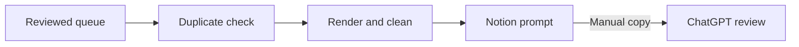

# Human-reviewed prospecting CRM

A personal **n8n + Notion** workflow that turns reviewed public business homepages into structured research prompts for manual review in ChatGPT.

**Status:** personal prototype · sanitized export · manual AI review

## Workflow at a glance

The workflow validates the configured queue, checks duplicate keys, renders page content through Browserless, removes heavy HTML, and saves a copyable prompt in Notion.

The review prompt asks for evidence of an unresolved need and checks whether the business already has an equivalent solution. Unknown internal processes remain unconfirmed. A person reviews the result before taking any commercial action.

## Design decisions

- **Human review:** AI is used manually; the workflow makes no AI API calls and sends no outreach.
- **Controlled scope:** only individually approved homepage targets are processed, with a configurable batch limit.
- **Traceable records:** duplicate keys, processing states and review material are stored in Notion.
- **Explicit uncertainty:** the prompt distinguishes public evidence from assumptions about internal systems.

## What is included

| File | Purpose |
|---|---|
| [manual-crm-demo.json](manual-crm-demo.json) | Sanitized, 19-node n8n workflow export |
| README.md | Architecture, setup requirements and validation scope |

The sample contains no account credentials or real prospect records. It ships with `active:false`, `enabled:false` and an empty target queue.

## Validation

| Scope | Evidence |
|---|---|
| Original local deployment | 30 offline checks passed; a synthetic Notion record was written, read back and checked with its relation, then archived |
| Public export | JSON and prompt syntax checked; disabled configuration and credential-reference removal inspected |
| Separate installation | Not imported or tested yet |

These are prototype checks. No paid client delivery, production track record, measured savings or commercial results are claimed.

## Setup requirements

This repository is a workflow sample, rather than a complete deployment bundle.

1. Import the JSON into a compatible n8n instance and keep it inactive.
2. Provide a Browserless service and your own Notion and Browserless credentials for the HTTP nodes.
3. Adapt the Notion data source, properties and relations used by the nodes; replace the placeholder in **Configuración**.
4. Add one reviewed, explicitly approved homepage target with its niche relation and requested service.
5. Review the configuration and run manually in a test workspace before considering scheduled use.

Node labels are in Spanish. The export expects the corresponding Notion schema and Browserless endpoint; these require configuration.

## Known limitations

- URL validation is lexical; it does not provide complete DNS, redirect or subresource network isolation.
- Duplicate lookup and insertion are separate operations. Concurrent writers are not supported.
- Automatic retries are not implemented across the workflow.
- Full backup restoration and import into a separate installation remain unverified.
- Prompt instructions support human judgment; they do not certify a business need or authorize contact.

## Project contribution

**Project owner:** goals, scope, priorities, operating decisions and coordination.

**AI-assisted work:** implementation, documentation and technical checks.

This project demonstrates a documented research-and-review process while keeping its evidence and limitations visible.
